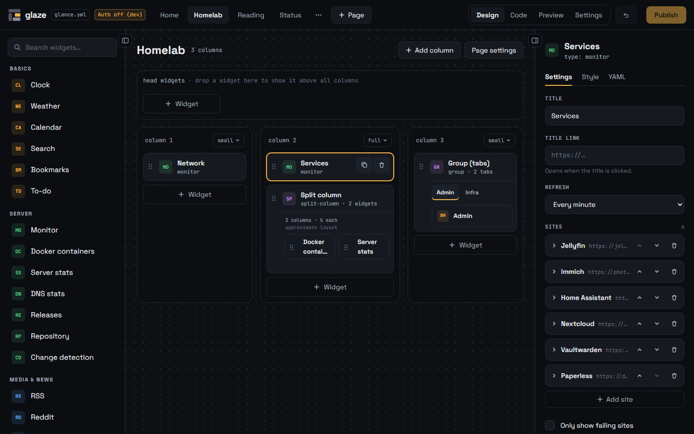
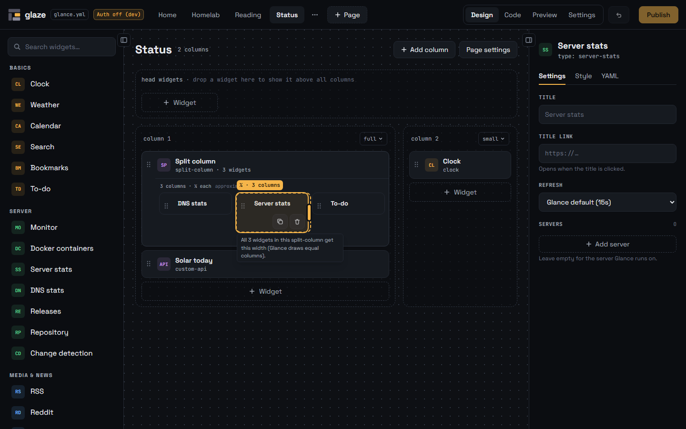
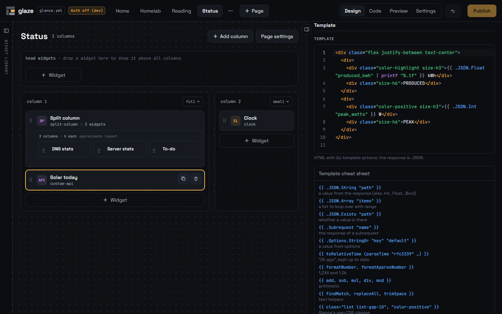
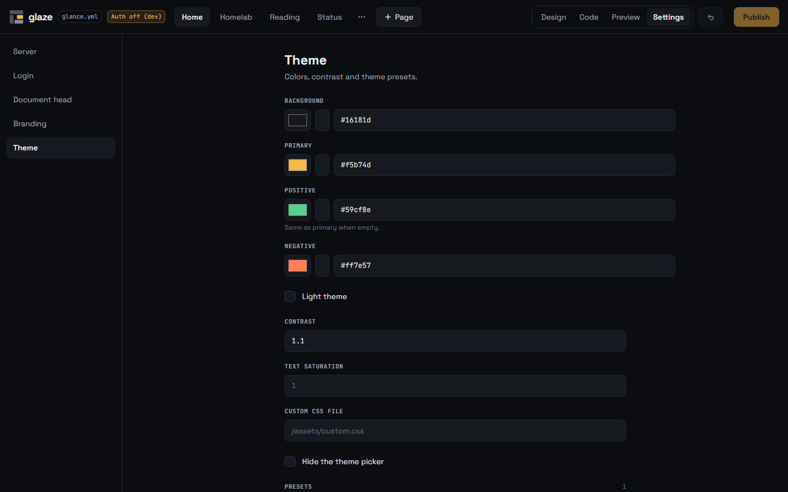
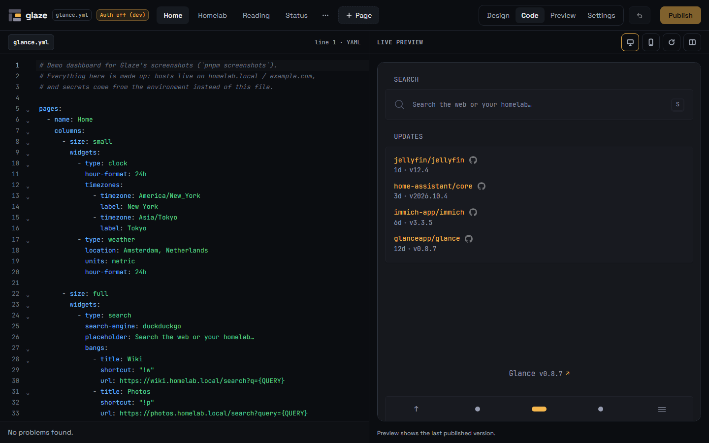
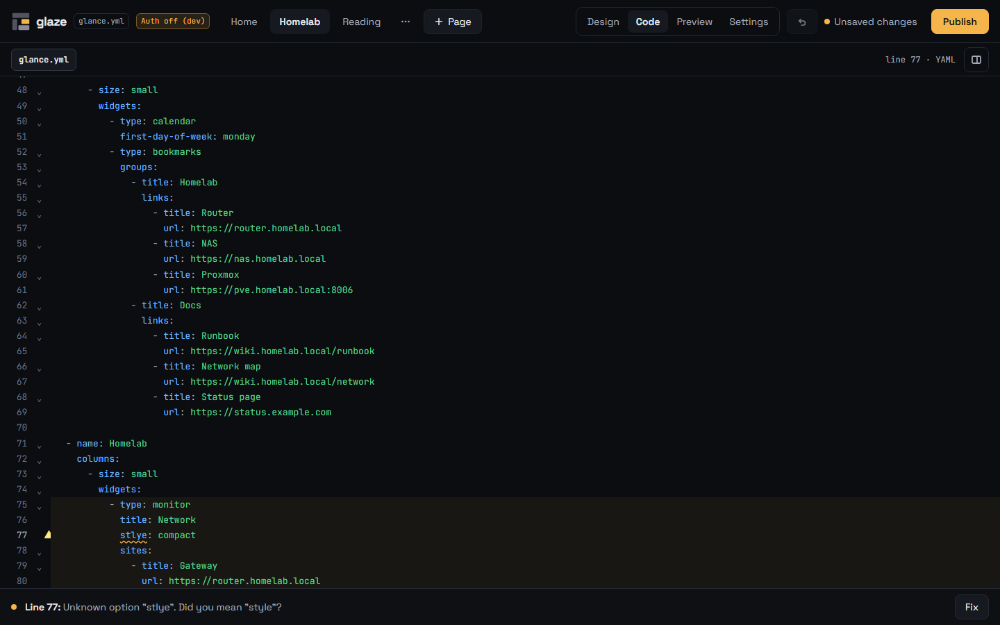
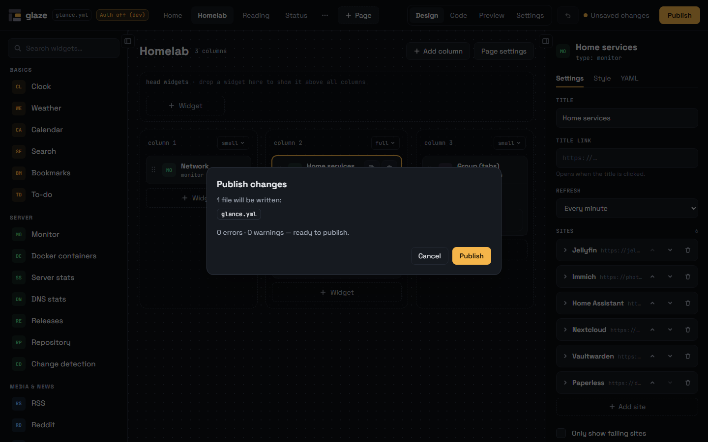

<div align="center">


# Glaze

**A visual editor for [Glance](https://github.com/glanceapp/glance) dashboards.**
Drag, drop and configure your pages instead of hand-writing YAML.

[](https://github.com/glazeforglance/glaze/releases/latest)
[](https://github.com/glazeforglance/glaze/actions/workflows/ci.yml)
[](LICENSE)

</div>



## Why Glaze?

Glance is a fast, beautiful self-hosted dashboard, configured entirely through one `glance.yml`. Glaze runs next to it and gives you a visual editor on top of that same file:

- **Drag & drop layout:** pages, columns and widgets, following Glance's own layout rules, so what you build is always something Glance can render.
- **Every Glance option has a form:** all 28 widget types, page settings and the global settings (server, Glance's login, document head, branding, theme with presets), generated from Glance's own source. No more guessing option names or fighting indentation.
- **Widgets side by side:** drop a widget beside another and drag its edge to ½, ⅓ or ¼, the way Glance's `split-column` does it.
- **A custom-api editor:** request, headers and template in one place, with highlighting and a cheat sheet of Glance's template functions.
- **Your YAML stays yours:** Glaze edits `glance.yml` in place and keeps your comments, anchors and ordering intact.
- **Code view with live preview:** switch to the YAML at any time, with the real Glance next to it.
- **Validation before writing:** YAML syntax, layout rules, missing required options, unknown options with one-click fixes, and `glance config:validate` itself.
- **One container:** a small Docker image next to Glance, with a login in front.

**What Glaze can't do (yet):** set a widget's height, edit the theme with a live preview, build widgets from blocks, or give several people their own Glaze login. See the [roadmap](#roadmap).

## Screenshots

New to Glaze? **[Using Glaze](docs/usage.md)** walks through every view, step by step.

<table>
  <tr>
    <td width="50%"></td>
    <td width="50%"></td>
  </tr>
  <tr>
    <td><b>Side by side:</b> drag a widget's edge to ½, ⅓ or ¼.</td>
    <td><b>custom-api:</b> write a template with a cheat sheet at hand.</td>
  </tr>
  <tr>
    <td></td>
    <td></td>
  </tr>
  <tr>
    <td><b>Settings:</b> server, Glance's login, branding and theme as forms.</td>
    <td><b>Code + preview:</b> edit the YAML next to your real Glance.</td>
  </tr>
  <tr>
    <td></td>
    <td></td>
  </tr>
  <tr>
    <td><b>Validation:</b> typos are caught before they reach Glance, with a one-click fix.</td>
    <td><b>Publish review:</b> see what will be written and what's still wrong.</td>
  </tr>
</table>

## How it works

```
             ┌──────────────┐        reads        ┌───────────────────┐
  you  ───►  │    Glance    │ ◄────────────────── │                   │
             └──────────────┘                     │  shared config    │
             ┌──────────────┐        writes       │  folder           │
  you  ───►  │    Glaze     │ ──────────────────► │  glance.yml       │
             └──────────────┘                     │  assets/          │
                                                  └───────────────────┘
```

Glaze and Glance share the same config folder. Your edits stay a draft in the browser until you press **Publish**: Glaze then validates the config and writes `glance.yml`, and Glance notices the change and reloads automatically. Glance stays your dashboard; Glaze is just the tool you use to shape it.

## Quick start

You need Docker with Compose, and a folder with your `glance.yml` (for example `./config/glance.yml`).

> [!NOTE]
> Images up to v0.1.1 were published as `ghcr.io/klingesean/glaze`. That image no longer gets updates, so switch your compose file to `ghcr.io/glazeforglance/glaze`.

**1. Create a password hash** for the Glaze login:

```bash
docker run --rm -it ghcr.io/glazeforglance/glaze:latest hash-password
```

Type your password twice (nothing is shown while you type). The output is one line like `scrypt:32768:8:1:…:…`. It contains only letters, digits, `-`, `_` and `:`, so you can paste it anywhere as is: no quotes, no escaping.

**2. Add Glaze next to Glance** in your `compose.yml` (also in [`docker/compose.example.yml`](docker/compose.example.yml)) and paste your hash:

```yaml
services:
  glance:
    image: glanceapp/glance:v0.8.7
    restart: unless-stopped
    volumes:
      - ./config:/app/config
      - ./config/assets:/app/assets # server.assets-path: /app/assets
    ports:
      - "8080:8080"

  glaze:
    image: ghcr.io/glazeforglance/glaze:latest
    restart: unless-stopped
    # Glaze runs as uid 1000; see docs/installation.md#file-permissions.
    # user: "1000:1000"
    volumes:
      - ./config:/config # the same folder Glance uses
    ports:
      - "8090:8090"
    environment:
      # Fake example: replace it with the output of step 1.
      GLAZE_ADMIN_PASSWORD_HASH: scrypt:32768:8:1:FAKEsaltReplaceMe0000w:FAKEhashRunHashPasswordAndPasteYourOwn00000
      GLAZE_ASSETS_PATH: /config/assets # the folder Glance serves as /assets/
      GLANCE_URL: http://localhost:8080 # where your browser reaches Glance
```

**3. Start it and log in:**

```bash
docker compose up -d
```

Open <http://localhost:8090> and log in as `admin` with the password from step 1. Make a change, press **Publish** (or `Ctrl/Cmd + S`), and Glance reloads with it.

> [!IMPORTANT]
> Glaze can change your dashboard config, including API keys. Keep it behind its login, and don't expose it to the internet without extra protection. See [Security](#security).

## Documentation

| Guide                                    | What's in it                                                                         |
| ---------------------------------------- | ------------------------------------------------------------------------------------ |
| [**Using Glaze**](docs/usage.md)         | **Start here:** the views, pages, columns, widgets, settings, publishing, shortcuts  |
| [Installation](docs/installation.md)     | The full Docker Compose walkthrough, password options, file permissions, updating    |
| [ZimaOS / CasaOS](docs/zimaos-casaos.md) | Installing Glaze as a custom app                                                     |
| [Configuration](docs/configuration.md)   | All environment variables, validation with Glance, the live preview, asset files     |
| [Security](docs/security.md)             | How to run Glaze safely, sessions, reverse proxies                                   |
| [Development](docs/development.md)       | Running from source, building, the Docker smoke test, screenshots, project structure |
| [Changelog](CHANGELOG.md)                | What changed in each release                                                         |

## Security

Anyone who can use Glaze can change your dashboard config, including the API keys in it. Keep it behind its login, don't expose it publicly without an extra layer in front (Cloudflare Access, a VPN, or LAN only), and set `GLAZE_TRUST_PROXY=true` behind a reverse proxy. The details are in [docs/security.md](docs/security.md). Found a vulnerability? Please report it privately, see [SECURITY.md](SECURITY.md).

## Roadmap

- **Available:** the visual editor with drag & drop; a form for every Glance option (all 28 widget types, page settings, and the server, Glance's login, document head, branding and theme with presets); widgets side by side through split-columns; column widths by dragging; the custom-api editor; the code view with live preview; validation; and the Docker image with a login.
- **Next:** undo, an "Edit page" button in Glance, widget heights, a theme editor with live preview, and a widget builder for custom-api.
- **Later:** multiple Glaze users, each with their own login.

The details and the reasoning behind them are in [docs/DESIGN.md](docs/DESIGN.md).

## Contributing

Ideas, bug reports and pull requests are very welcome. See [CONTRIBUTING.md](CONTRIBUTING.md) for the setup and conventions, or open an issue with your use case or the widgets you'd most like to see supported next.

## License

[MIT](LICENSE) © 2026 Sean Klinge

---

<sub>Glaze is a community project and is not affiliated with or endorsed by the Glance project. Glance is licensed under AGPL-3.0; Glaze does not contain Glance code and only reads and writes its configuration format. The Docker image ships the unmodified Glance binary (v0.8.7, AGPL-3.0, source at [glanceapp/glance](https://github.com/glanceapp/glance)) to run `glance config:validate`.</sub>
